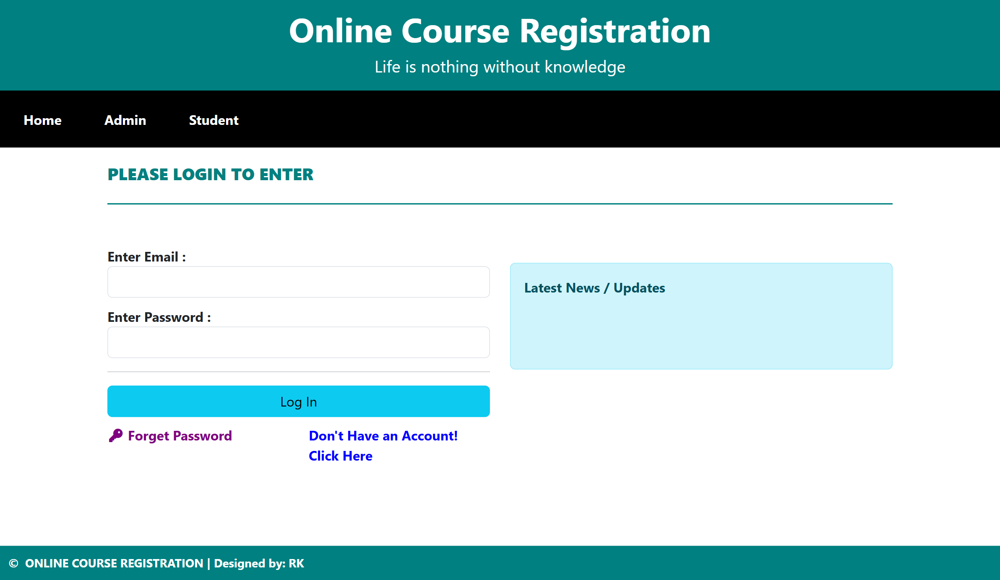
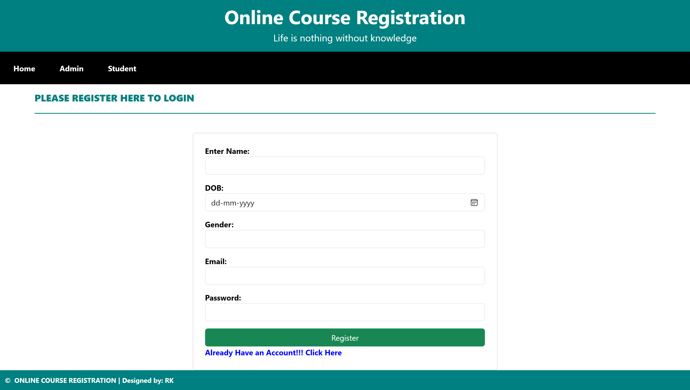
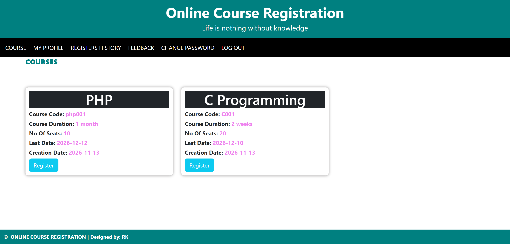
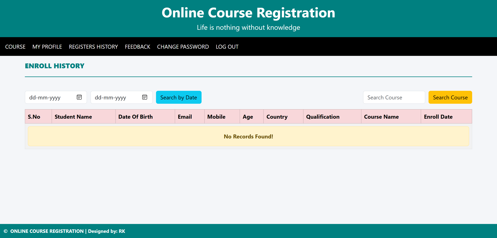
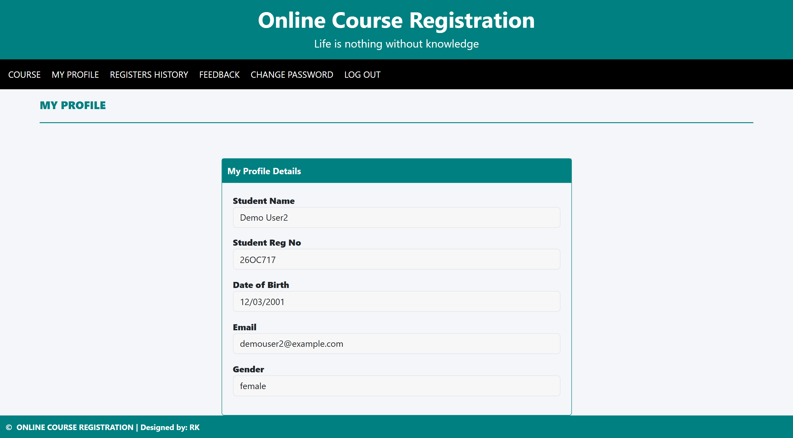
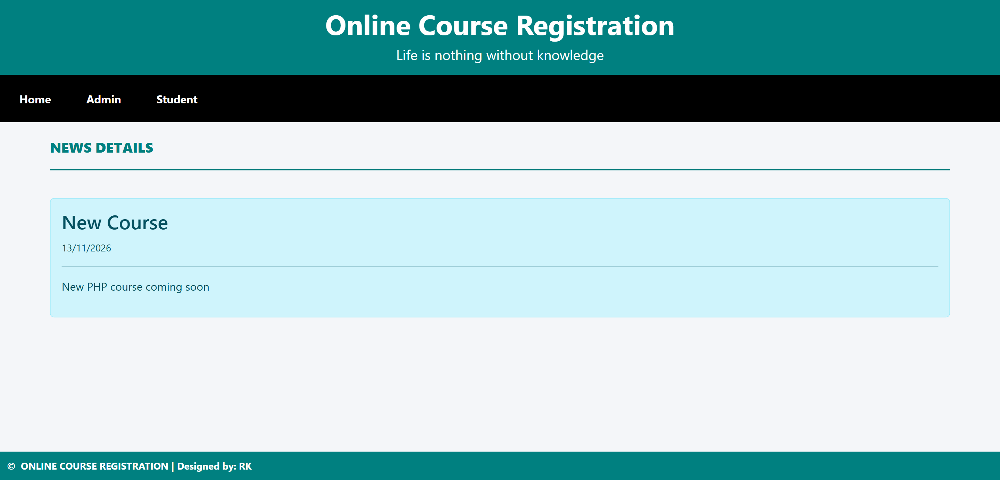
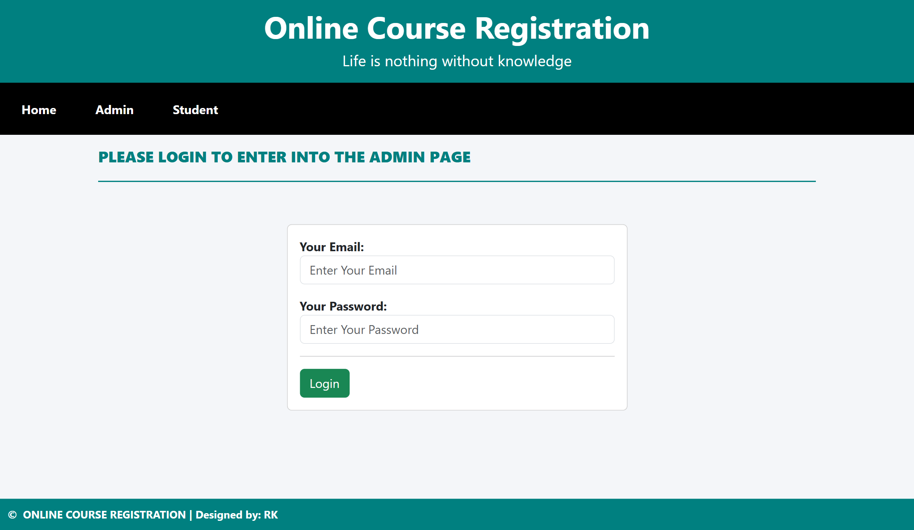
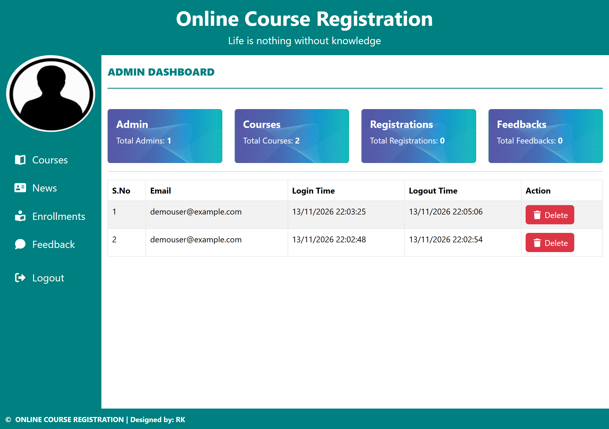
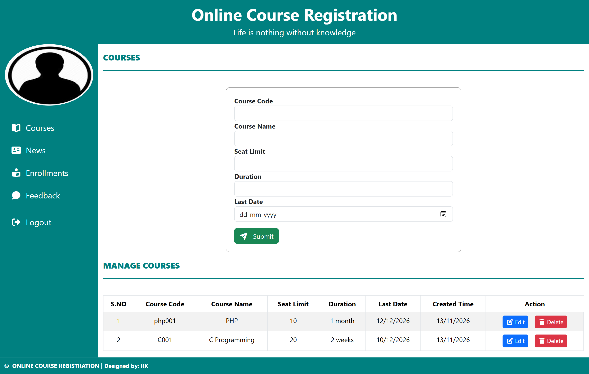

# Online Course Registration System


### Live Demo
[View Live Project](https://course-registration.infinityfree.io/)

### Source Code
[GitHub Repository](https://github.com/Raj-Kumar-89/Online-Course-Registration-System-Using-PHP)

---
A web-based **Online Course Registration System** developed using **PHP, MySQL, HTML, CSS, JavaScript, and Bootstrap**. The system allows students to register, browse available courses, enroll in courses, manage their profiles, and provide feedback. It also includes an administrative panel for managing courses, students, news, and enrollment records.

---

## Project Overview

The Online Course Registration System simplifies the traditional course enrollment process by providing an easy-to-use online platform for students and administrators.

Students can create an account, log in securely, browse courses, enroll, and view their enrollment history. Administrators can manage courses, monitor enrollments, publish news, and review student feedback.

---

## Features

### Student Module

- Student Registration
- Secure Login & Logout
- Forgot Password
- Change Password
- View Available Courses
- Register for Courses
- View Enrollment History
- Manage Profile
- Submit Feedback
- Print Course Registration Details
- View Course News & Updates

---
## Screenshots / Application Preview

<table>
  <tr>
    <td></td>
    <td></td>
  </tr>
  <tr>
    <td align="center">Home Page</td>
    <td align="center">Student Login</td>
  </tr>
  <tr>
    <td></td>
    <td></td>
  </tr>
  <tr>
    <td align="center">Student Register</td>
    <td align="center">Course Page</td>
  </tr>
    <tr>
    <td></td>
    <td></td>
  </tr>
  <tr>
    <td align="center">Course Enroll-History</td>
    <td align="center">Student Profile</td>
  </tr>
    <tr>
    <td></td>
    <td></td>
  </tr>
  <tr>
    <td align="center">News-Details Page</td>
    <td align="center">Admin Login</td>
  </tr>
    <tr>
    <td></td>
    <td></td>
  </tr>
  <tr>
    <td align="center">Admin Dashboard</td>
    <td align="center">Course Page - Admin</td>
  </tr>
</table>

---

### Admin Module

- Secure Admin Login
- Dashboard
- Add New Courses
- Edit Existing Courses
- View Student Enrollment History
- Manage Course News
- View Student Feedback
- Logout

---

## Technologies Used

| Technology | Purpose |
|------------|----------|
| HTML5 | Page Structure |
| CSS3 | Styling |
| Bootstrap | Responsive UI |
| JavaScript | Client-side Validation |
| PHP | Backend Development |
| MySQL | Database |
| XAMPP | Local Server |

---

## Project Structure

```text
ONLINECOURSE/
├── admin/
│   ├── img/
│   ├── includes/
│   ├── adminlogin.php
│   ├── dashboard.php
│   ├── course.php
│   ├── edit-course.php
│   ├── enroll-history.php
│   ├── feedbackview.php
│   ├── news.php
│   └── logout.php
│
├── assets/
│   ├── css/
│   │   ├── font-awesome/
│   │   ├── bootstrap.css
│   │   ├── bootstrap.min.css
│   │   └── style.css
│   │
│   └── js/
│       ├── bootstrap.js
│       └── bootstrap.min.js
│
├── includes/
│   ├── connect.php
│   ├── header.php
│   ├── footer.php
│   └── user-menubar.php
│
├── user/
│   ├── register.php
│   ├── login.php
│   ├── logout.php
│   ├── forgotpassword.php
│   ├── change-password.php
│   ├── my-profile.php
│   ├── course.php
│   ├── regcourse.php
│   ├── enroll-history.php
│   ├── feedback.php
│   ├── newsdetails.php
│   └── print.php
│
└── index.php
│
└──SQL file/
    └── onlinecourse.sql
```

---

## Database

The application uses a MySQL database to store all application data.

### Main Tables

- Students
- Courses
- Course Registration
- Admin
- Feedback
- News

The database uses **Primary Keys**, **Foreign Keys**, and relational concepts to maintain data integrity.

---

## Workflow

### Student

1. Register an account
2. Login
3. Browse available courses
4. Register for preferred courses
5. View enrollment history
6. Update profile
7. Submit feedback
8. Print registration details

### Administrator

1. Login
2. Access Dashboard
3. Add/Edit Courses
4. View registered students
5. Manage News
6. Review Feedback
7. Logout

---

## Installation

### Step 1

Clone the repository

```bash
git clone https://github.com/Raj-Kumar-89/Online-Course-Registration-System-Using-PHP.git
```

---

### Step 2

Move the project folder into

```
xampp/htdocs/
```

---

### Step 3

Start

- Apache
- MySQL

from the XAMPP Control Panel.

---

### Step 4

Open phpMyAdmin

```
http://localhost/phpmyadmin
```

---

### Step 5

Create a database

```
onlinecourse
```

---

### Step 6

Import

```
onlinecourse.sql
```

---

### Step 7

Run the application

```
http://localhost/onlinecourse
```

## Security Features

- User Authentication
- Session Management
- Password Change Module
- Admin Authentication
- Input Validation
- Database Connectivity using PHP

---

## Concepts Used

- CRUD Operations
- User Authentication
- Session Handling
- PHP & MySQL Connectivity
- Form Validation
- Relational Database Design

---

## Future Enhancements

- Email Verification
- OTP-Based Password Reset
- Course Search & Filter
- Student Dashboard Analytics
- Faculty Module
- Attendance Management
- Online Payment Integration
- Certificate Generation
- Mobile Responsive Improvements

---

## Learning Outcomes

This project helped in understanding:

- Full Stack Web Development
- PHP Backend Programming
- MySQL Database Design
- CRUD Operations
- Authentication & Authorization
- Session Management
- Database Integration

---

# Author

**Raj Kumar**

Software Developer

- GitHub: https://github.com/Raj-Kumar-89
- LinkedIn: https://www.linkedin.com/in/raj-kumar13/
- Portfolio: https://raj-kumar-portfolio-delta.vercel.app/

---

## License

This project is intended for educational and portfolio purposes.
